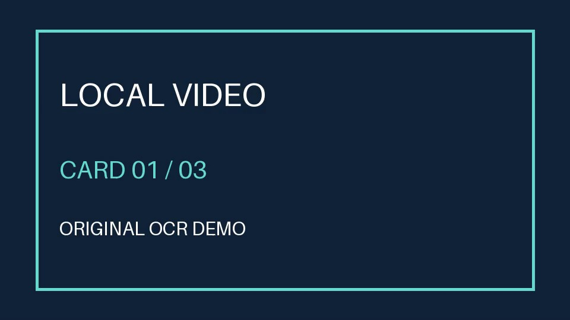

# 视频证据读取 · Video Link Reader

从单个视频或本地文件整理可追溯证据：先取元数据与字幕，需要时抽样画面做OCR，并可接入可选语音转写。记录抽样时间、文字、警告和未覆盖范围，避免把简介或几张画面当成完整观看。



## 最简运行：读取自带的原创视频

本轮实测环境为Windows、Python3.12。创建虚拟环境，在环境中执行：

```sh
python -m pip install -r requirements.txt
python scripts/analyze.py examples/demo.mp4 --fast --max-frames 3 --out .runtime/demo
```

打开`.runtime/demo/evidence.json`和`frames/`。自带视频是用Pillow/FFmpeg生成的6秒无声文字卡片，不涉及第三方视频。此次三个画面均实际识别成功，公开的[结果摘录](examples/demo-evidence.json)保留时间和识字结果并去除本机绝对路径。退出码0只说明基本采集入口成功，仍须检查warnings、frames和每帧ocr_error。

## 链接、字幕与可选转写

`yt-dlp`已按本轮版本锁定；链接功能受站点支持、网络、内容权限影响。需要下载/合并在线视频时，在PATH中安装有权使用的FFmpeg；也可用`VIDEO_READER_FFMPEG_DIR`指定其目录。工具不随仓库分发，不自动加载个人yt-dlp配置或Cookie。

```sh
python scripts/analyze.py '<public-video-url>' --visual --out '<private-output-dir>'
```

语音转写另需`whisper-ctranslate2`和用户有权获取的模型，安装后才可使用`--asr`或`--asr-if-no-caption`。本轮未安装/验证语音模型，也未实测特定站点的视频下载、登录、字幕获取。安装Skill不提供付费服务、账号或读取权限。

## 作为Skill与目录

把完整目录放入支持SKILL.md的宿主用户技能目录，按宿主方式调用`video-link-reader`。`SKILL.md`约定证据阅读与总结；`scripts/analyze.py`为Python分析器；`examples/`为原创素材、生成方法与验证摘录；`docs/`为真实抽帧和验证范围。

工具优先从同一Python环境或PATH寻找，可通过`VIDEO_READER_YTDLP`、`VIDEO_READER_WHISPER`、`VIDEO_READER_FFMPEG_DIR`覆盖。结果默认在当前目录`.runtime/results/`，实际视频、字幕、转写与私密链接另存私有目录，勿提交。

## 验证、更新与计划

2026-10-26：保留原有完整分析器和工作流，替换固定机器路径，禁止隐式读取yt-dlp配置，补充缺少命令时的可读错误。本轮新建独立环境，真实解码6秒视频并抽取0/2.95/5.9秒三帧、OCR识字通过，未逐帧观看、核实连续动效或音频。后续针对有授权的实际站点、字幕与语音补充验证，完整宿主对话尚未重测。

自有脚本、文档与原创演示采用[MIT](LICENSE)。RapidOCR、ONNX Runtime、OpenCV、yt-dlp、FFmpeg、转写器与模型各遵循原许可；本仓库不重新许可或捆绑其二进制和模型。OCR安装依照[RapidOCR官方说明](https://rapidai.github.io/RapidOCRDocs/main/en/install_usage/rapidocr/install/)。
